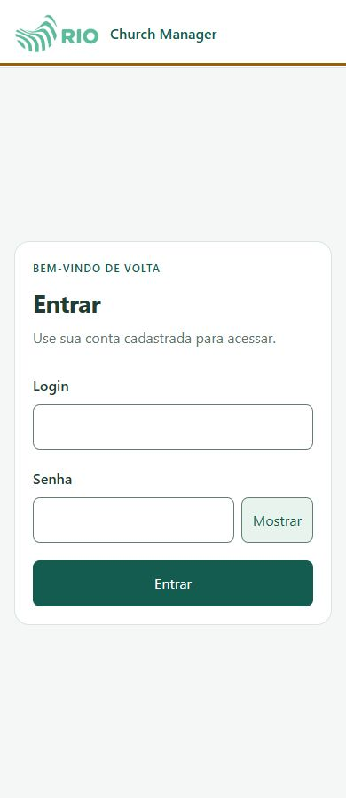
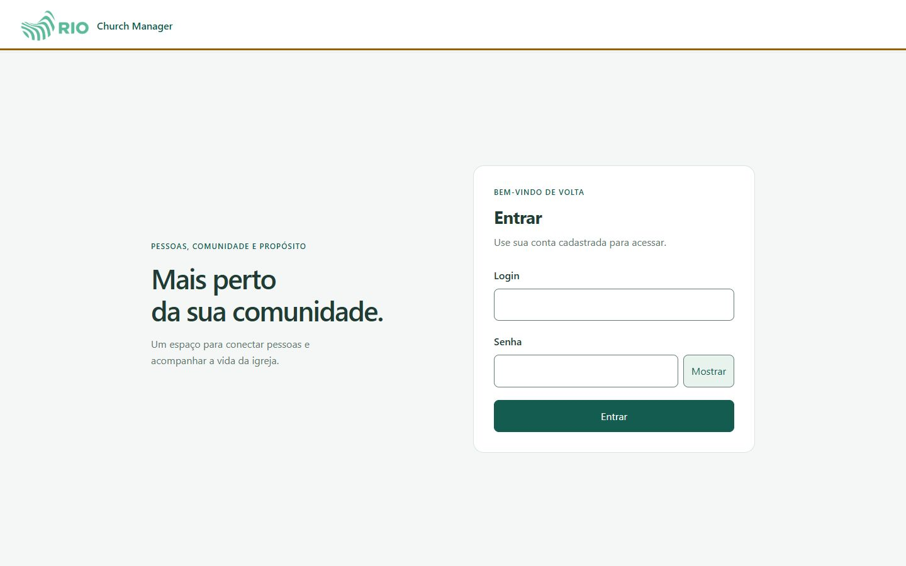
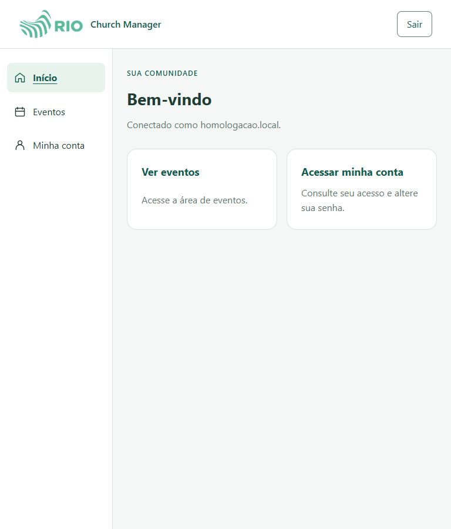
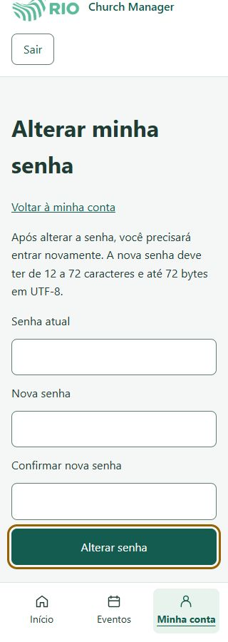

# UI-RIO-08 — validação parcial em localhost:5173

## Identificação

Issue canônica [#34](https://github.com/vinnigump/church_manager_frontend/issues/34),
módulo Qualidade, épico UI-RIO, prioridade P1. Data: 2026-11-07 UTC.
Responsável: agente desta atividade, inspeção e revisão sequenciais; sem
parecer independente ou aceite humano simulado.
Branch documental `codex/ui-rio-08-local-validation`, base `86f0821`.

Endereço solicitado pelo usuário: `http://localhost:5173/`. Browser Use no
navegador integrado conseguiu acessar e autenticar a conta de homologação
fornecida pelo usuário. Nenhuma credencial foi incluída nos artefatos.
O servidor Vite da porta 5173 já estava ativo (PID 18704); não foi iniciado,
encerrado ou reconfigurado nesta validação. Seu diretório/SHA não foi
comprovado pelos argumentos do processo. Portanto **não atribuir estas capturas
a um head específico de PR**, nem tratá-las como aceite do #54/#56/#58.
O checkout principal consultado estava em `eef6208`; isso não prova o bundle servido.

## Critérios do ensaio parcial

| ID | Critério | Resultado | Evidência |
| --- | --- | --- | --- |
| LOCAL-01 | Login real com conta de homologação e apresentação autenticada | PASSOU | Browser Use abriu Home e Minha conta após autenticar; protected-account-return.png |
| LOCAL-02 | Sem rolagem horizontal em 320/360/390/768/1024/1440 | PASSOU | metrics.json, authenticated-metrics.json, password-metrics.json: scrollWidth <= innerWidth nas 24 medições |
| LOCAL-03 | Campos mobile >=16px; ações medidas >=44x44px | PASSOU | JSONs de medidas do login/conta/Home/formulário de senha |
| LOCAL-04 | Mostrar/ocultar senha, campos obrigatórios e foco de teclado | PASSOU | input alternou text/password, aria-pressed true, validação vazia focou login; Tab login→senha→mostrar, outline solid |
| LOCAL-05 | Rota conta sem sessão exige login e retorna ao destino após autenticar | PASSOU | protected-account-login.png e protected-account-return.png; URLs observadas /entrar e /conta |
| LOCAL-06 | Catálogos/calendário/ocorrências e seus estados críticos | NAO_TESTADO | Links reais de igreja/denominação solicitados ao usuário; contexto não descoberto nem adivinhado |
| LOCAL-07 | Zoom real200%, Safari/iOS, teclado virtual, leitor de tela | NAO_TESTADO | Ambiente atual não demonstrou esses ensaios; Ctrl+plus não alterou largura/DPR, não contou como zoom |
| LOCAL-08 | Vincular bundle ao SHA e obter aceite humano | NAO_TESTADO | Origem acessível não comprova versão servida ou aceite |

Esta tabela cobre o ensaio, não o inventário completo da issue #34.
Os resultados de geometria não comprovam contraste renderizado, todos os textos
longos, todos os estados, safe-area física ou homologação de um dispositivo real.

## Evidências e observações

- Login: seis larguras, sem navegação interna para visitante. Controles medidos
  com altura51,59px; campos16px. Mostrar/ocultar testado somente com texto
  sintético, limpo antes de autenticar. Formulário vazio bloqueou envio nativo.
- Home e Minha conta: seis larguras cada; uma única navegação, em fluxo normal
  (`position: static`), foco em main e títulos correspondentes após navegação.
- Formulário de senha: seis medições de layout, sem preencher nova senha ou
  submeter alteração. Em320 há rolagem vertical; o foco no botão final manteve
  ação visível acima da navegação. Não valida a mutação de senha.
- Saída removeu menus autenticados; a tentativa posterior de abrir conta
  apresentou login, e nova autenticação retornou à conta solicitada.
  A transição final da saída para a Home pública não foi isoladamente capturada:
  a navegação à conta começou enquanto o estado “Saindo…” ainda aparecia.
- Captura fullPage do formulário estreito produziu imagem inconsistente com
  DOM e viewport visível. Essas capturas foram excluídas desta entrega; as duas
  imagens320 do formulário usam captura do viewport, incluindo o foco final.
  Não classificado como defeito de layout sem reprodução na tela normal.
- Viewport temporário restaurado. Sessão de homologação preservada na aba
  para continuação; sem publicação, criação de registros, mudança de senha ou
  encerramento do servidor do usuário.

Capturas selecionadas:







## Testes, revisão e decisão

Browser Use real com DOM, screenshots e navegação, sobre serviço local já ativo.
Nenhum mock de login/API injetado; nenhuma modificação de UI ou estado escondido.
Não foram reexecutados npm ci/lint/typecheck/test/build para atribuir cobertura
a esse serviço de SHA desconhecido; esta branch altera somente documentação
e artefatos. `git diff --check` verifica a entrega documental; CI do PR é uma
verificação separada do código da base, não prova da versão renderizada.

Parecer: APROVADO_COM_RESSALVAS para o ensaio parcial; revisão independente
PENDENTE. Sem defeito funcional reproduzido nas telas percorridas. Restam
contextos de Eventos, identificação da versão servida, demais estados/ambientes
e aceite. PODE_CONCLUIR: NAO.

```yaml
atividade: UI-RIO-08-LOCAL-5173
issue: https://github.com/vinnigump/church_manager_frontend/issues/34
status: EM_TESTES
criterios_total: 8
criterios_comprovados: 5
testes_aprovados: 5
testes_falhos: 0
testes_ignorados: 0
ci: NAO_EXECUTADO
ci_url: null
sha_validado: null
revisao: PENDENTE
prs: []
bloqueios: [links_contextuais_eventos, sha_servido_nao_comprovado, ambientes_restantes, aceite_humano]
proxima_acao: Obter links autorizados e identificar a versao servida para completar a matriz
pode_concluir: false
aceite_humano: PENDENTE
```

## Orientação posterior e atualização documental — 2026-11-07 UTC

O usuário dispensou validação visual como requisito dos PRs. Este relatório
preserva apenas evidências históricas e seus limites; não bloqueia entregas,
não declara testes pendentes aprovados e não comprova um SHA servido específico.
Branch do PR #59 atualizada com main f72b9fe sem conflito. Diff contra a base
contém exclusivamente documentação e artefatos já registrados. git diff --check
passou; suíte local não reexecutada nesta atualização documental. CI do novo head
será registrado no PR, sem atribuir seus resultados ao antigo serviço capturado.
Revisão estática sequencial sem críticos/altos; revisão independente pendente.
Sem merge em main, deploy ou alteração de código funcional.
